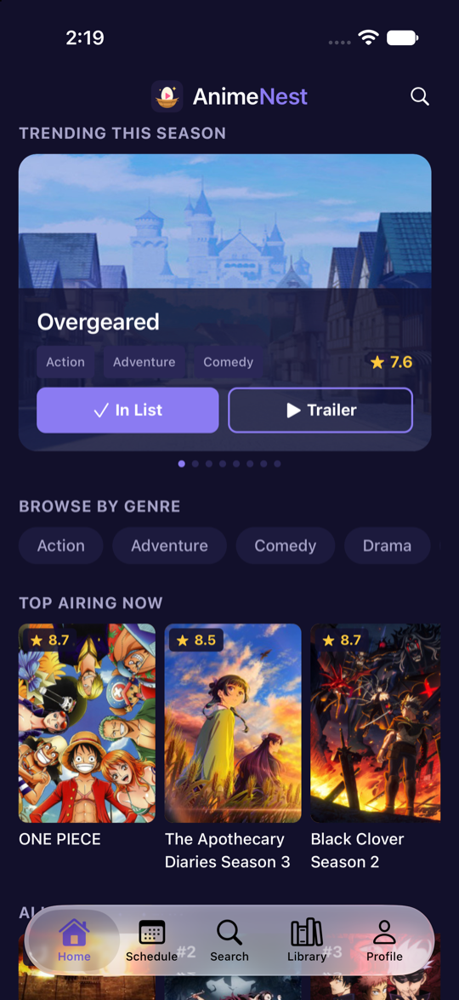
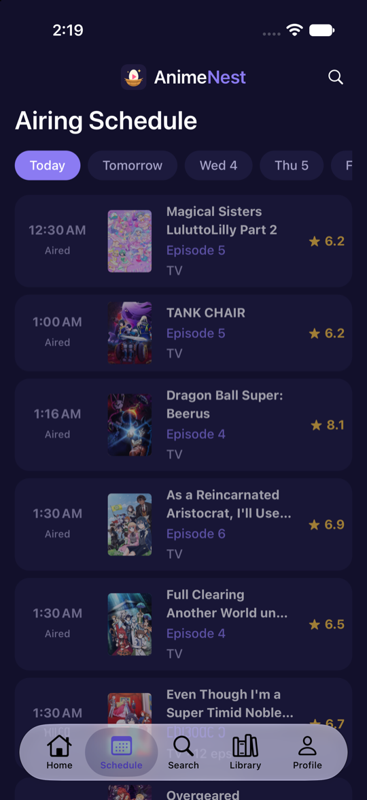
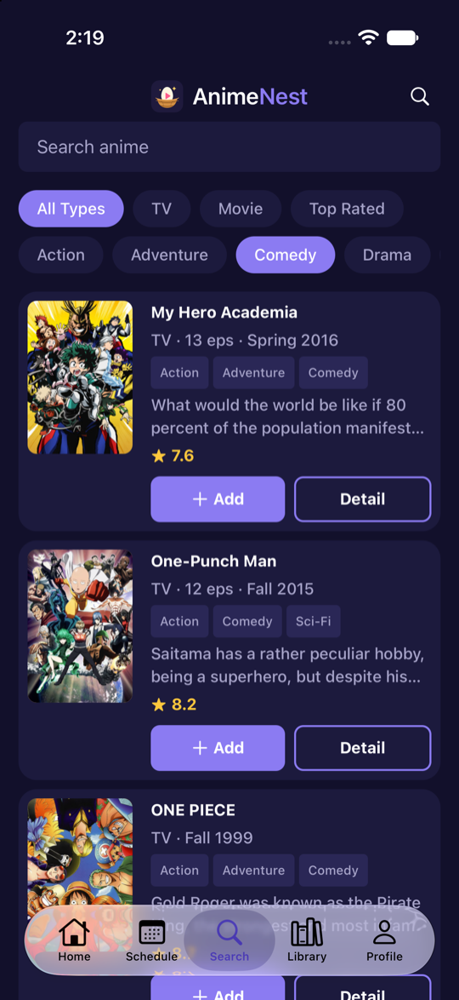
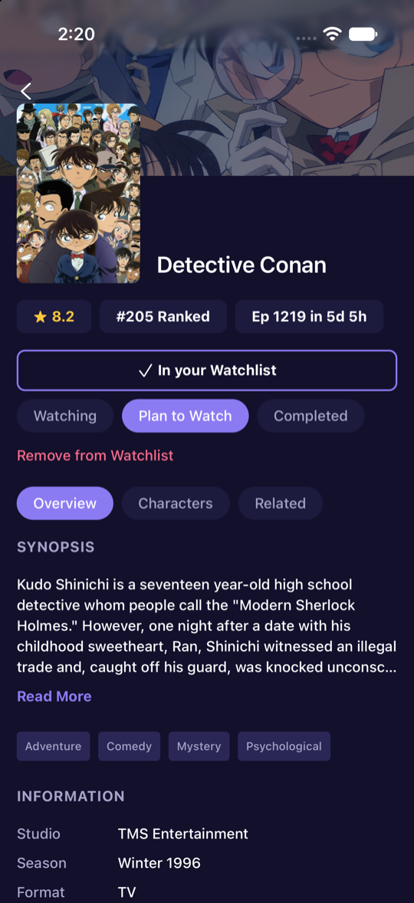
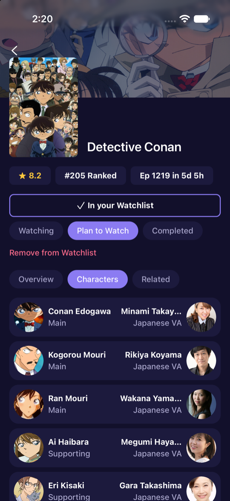
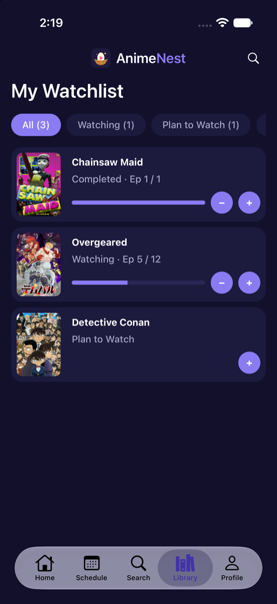
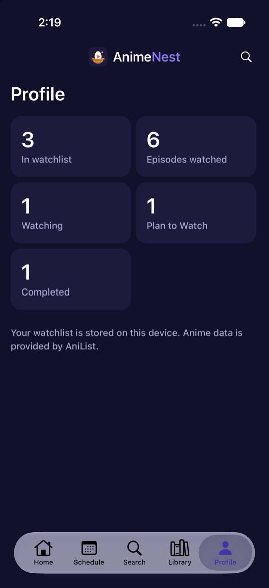

# AnimeNest

AnimeNest is a cross-platform mobile app (iOS, Android, web) for discovering anime. It uses the [AniList](https://anilist.co) GraphQL API to browse anime lists and view anime details, and lets you build your own watchlist.

Built with [Expo](https://expo.dev) (SDK 58), React Native and [Expo Router](https://docs.expo.dev/router/introduction).

## Screenshots

| Home | Schedule | Search by genre | Details |
| :---: | :---: | :---: | :---: |
|  |  |  |  |
| **Characters & cast** | **Watchlist** | **Profile** | |
|  |  |  | |

## Features

- **Home feed:** trending this season carousel, top airing now and all-time popular rows
- **Airing schedule:** the next 7 days of episodes, grouped by day with air times, plus a "next episode" countdown on each anime
- **Genre browsing:** genre chips on Home and Search, and tappable genre tags on the detail screen
- **Search:** debounced search with All Types, TV, Movie and Top Rated filters, combinable with a genre
- **Details:** banner, score, rank, synopsis, genres and info, with Overview, Characters (Japanese voice actors, recommendations) and Related tabs
- **Watchlist:** add anime in one tap, set Watching / Plan to Watch / Completed, and track episode progress. Stored on the device (SQLite on native, `localStorage` on web)
- **Profile:** simple stats from your watchlist
- Dark theme, pull to refresh, loading / error / empty states

## Tech stack

- Expo SDK 58, React Native 0.88, React 19, TypeScript
- Expo Router (file-based routing, native tabs)
- AniList GraphQL API (`https://graphql.anilist.co`), no API key needed
- `expo-sqlite` key-value store for the watchlist, `expo-image` for images

## Get started

1. Install dependencies

   ```bash
   npm install
   ```

2. Start the dev server

   ```bash
   npx expo start
   ```

`expo-sqlite` is a native module, so use a development build rather than Expo Go (see below).

## Run on a device or simulator

The native `ios/` and `android/` folders are generated (Continuous Native Generation) and gitignored. Don't edit them by hand; configure native behavior in `app.json` and config plugins.

| Command | What it does |
| --- | --- |
| `npm run ios` | Build and run on the iOS simulator |
| `npm run android` | Build and run on an Android emulator or device |
| `npm run web` | Start the web version |
| `npm run lint` | Lint the project |
| `npx tsc --noEmit` | Typecheck |

To regenerate the native projects after changing `app.json`, icons or plugins:

```bash
npx expo prebuild --clean
```

### Build an Android APK locally

With the Android SDK installed (`ANDROID_HOME` set):

```bash
npx expo prebuild --platform android
cd android && ./gradlew assembleRelease
# android/app/build/outputs/apk/release/app-release.apk
```

The template signs release builds with the debug keystore, which is fine for sideloading but not for Google Play.

## Project structure

```
src/
  app/                    Routes only (file-based routing)
    _layout.tsx           Root stack and theme
    (tabs)/               Home, Schedule, Search, Library, Profile
    anime/[id].tsx        Anime detail screen
  components/
    ui/                   Shared building blocks (button, chip, tag, states, icon...)
    screen.tsx            Safe-area page wrapper
    app-header.tsx        Brand header
    app-tabs.tsx          Native tab bar (app-tabs.web.tsx for web)
  features/
    anime/                AniList API client and queries, types, formatters,
                          data hooks and anime components
    schedule/             Airing schedule query, day grouping, hook and row
    watchlist/            Storage, store, hooks and watchlist components
  hooks/                  Generic hooks (use-async, use-debounced-value, use-theme)
  lib/                    Small helpers (navigation)
  constants/theme.ts      Colors and spacing
docs/screenshots/         README screenshots
assets/images/            App icon, adaptive icon, splash and favicon
```

Keep non-route code outside `src/app/`.

## Building and releasing

Builds and updates are handled with [EAS](https://docs.expo.dev/eas/):

```bash
npx eas-cli@latest build
npx eas-cli@latest submit
npx eas-cli@latest update
```

## Credits

Anime data is provided by [AniList](https://anilist.co).

## Learn more

- [Expo documentation](https://docs.expo.dev/)
- [Expo Router](https://docs.expo.dev/router/introduction)
- [AniList API docs](https://docs.anilist.co/)
