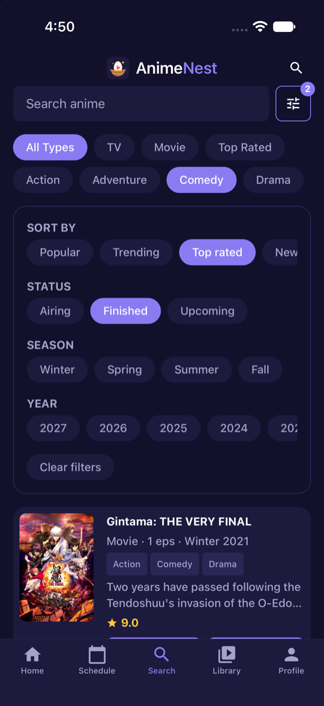
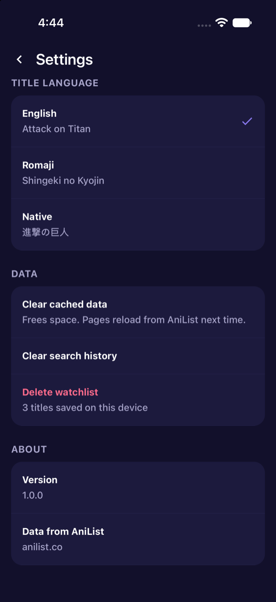
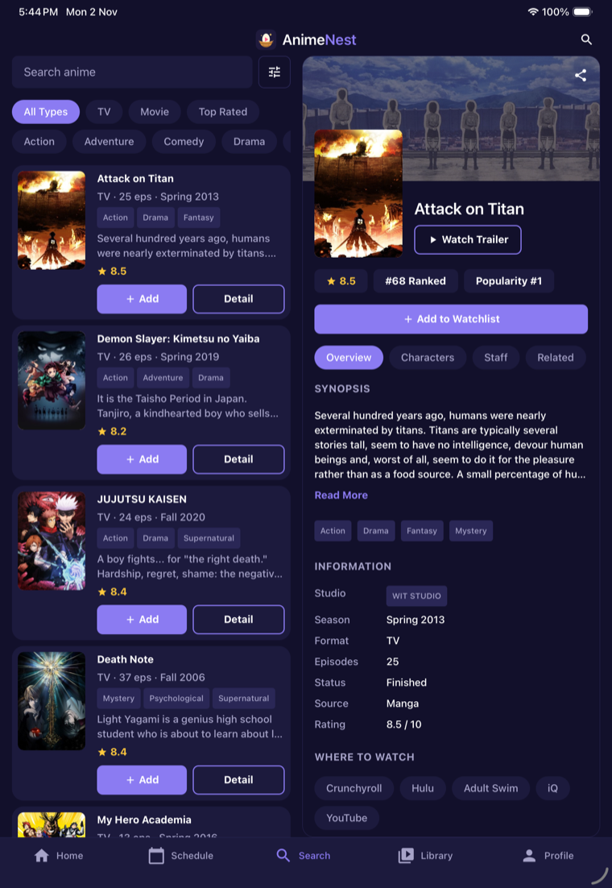
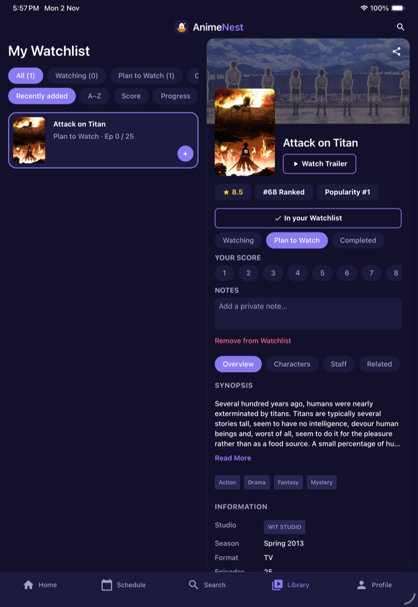
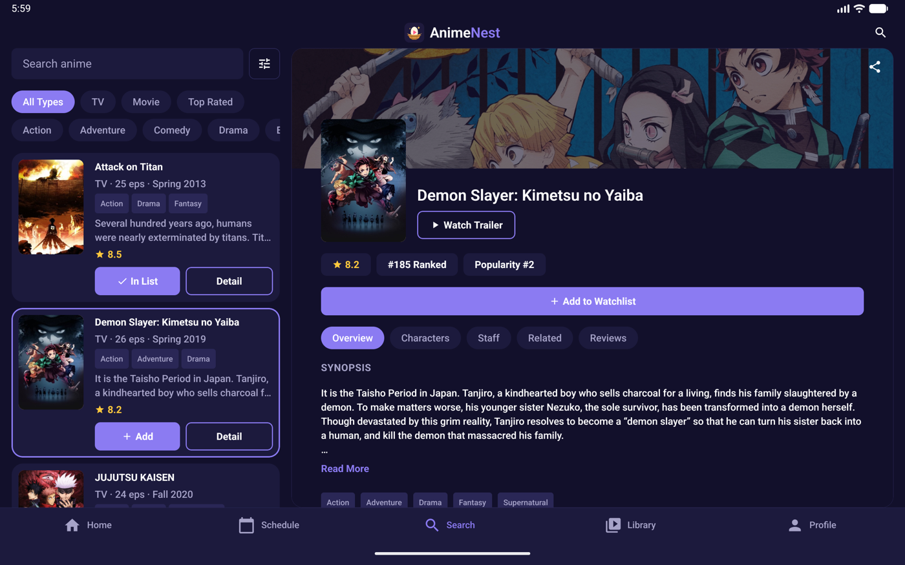

# AnimeNest

AnimeNest is a cross-platform mobile app (iOS, Android, web) for discovering anime. It uses the [AniList](https://anilist.co) GraphQL API to browse anime lists and view anime details, and lets you build your own watchlist.

Built with React Native (CLI) and React Navigation.

## Screenshots

| Home | Schedule | Search by genre |
| :---: | :---: | :---: |
|  |  |  |
| **Advanced filters** | **Details** | **Characters & cast** |
|  |  |  |
| **Watchlist** | **Profile and stats** | **Settings** |
|  |  |  |

### Tablets

On tablets, Schedule, Search and Library switch to a two-pane layout: the list on the left and the selected anime's full details on the right. The open item is highlighted in the list. Phones keep the single-pane screens.

| iPad: Search | iPad: Watchlist |
| :---: | :---: |
|  |  |



## Features

- **Home feed:** trending this season carousel, genre chips, and rows for top airing, popular this season, all-time popular, top rated, top movies, coming soon and recently finished, each with a "See all" screen that pages in more titles as you scroll
- **Airing schedule:** the next 7 days of episodes, grouped by day with air times, plus a "next episode" countdown on each anime
- **Genre browsing:** genre chips on Home and Search, and tappable genre tags on the detail screen
- **Search:** debounced search with All Types, TV, Movie and Top Rated filters, combinable with a genre
- **Details:** banner, score, rank, synopsis, genres and info, with Overview, Characters (Japanese voice actors, recommendations) and Related tabs
- **Watchlist:** add anime in one tap, set Watching / Plan to Watch / Completed, track episode progress, give your own 1-10 score and a private note, and sort by recently added, A-Z, score or progress. Stored on the device (MMKV)
- **Profile and stats:** titles, episodes and estimated time watched, your mean score, status counts and your top genres
- **Detail extras:** staff and studio pages, character and voice-actor pages, user reviews, where to watch (streaming links), an in-app trailer player and a share button
- **Search extras:** recent searches, advanced filters (sort, status, season, year) and a "Surprise me" button on Home
- **Offline cache:** Home, schedule, detail pages and "See all" lists are saved on the device, shown instantly and still available without a connection, with an "Updated ... ago" note
- **Settings:** title language (English, Romaji or Native), clear cached data, clear search history, delete watchlist
- **Tablet layout:** on tablets, Schedule, Search and Library show the list on the left and the selected anime's details on the right (phones keep single-pane screens)
- Dark theme, pull to refresh, loading / error / empty states

## Tech stack

- React Native 0.88 (CLI, bare workflow), React 19, TypeScript
- React Navigation (native stack and bottom tabs)
- AniList GraphQL API (`https://graphql.anilist.co`), no API key needed
- `react-native-mmkv` for the watchlist, settings and offline cache, `react-native-svg` for icons, `react-native-webview` for trailers

> The original Expo version of this app is kept on the [`expo`](../../tree/expo) branch.

## Get started

Requirements: Node 22.11+, Xcode and CocoaPods for iOS, Android Studio (SDK + JDK 17+) for Android. See the React Native [environment setup](https://reactnative.dev/docs/set-up-your-environment).

```bash
npm install
cd ios && pod install && cd ..   # iOS only

npm start                        # start Metro
npm run ios                      # in another terminal: run on the iOS simulator
npm run android                  # or run on an Android emulator / device
```

| Command | What it does |
| --- | --- |
| `npm run lint` | ESLint (with Prettier rules) |
| `npm run typecheck` | TypeScript check |
| `npm test` | Jest unit tests |
| `npm run pods` | `pod install` for iOS |

### Build an Android APK locally

With the Android SDK installed (`ANDROID_HOME` set):

```bash
cd android && ./gradlew assembleRelease
# android/app/build/outputs/apk/release/app-release.apk
```

Release builds are signed with the debug keystore by default, which is fine for sideloading but not for Google Play. Add your own keystore in `android/app/build.gradle` before publishing.

## Project structure

```
App.tsx                   Root: safe area, navigation container, theme
index.js                  App registration
src/
  screens/                Home, Schedule, Search, Library, Profile, Anime detail
  navigation/             Root stack, bottom tabs, route types, navigation ref
  components/
    ui/                   Shared building blocks (button, chip, rating, icon...)
    screen.tsx            Safe-area page wrapper
    master-detail.tsx     Tablet list + detail layout
    app-header.tsx        Brand header
  features/
    anime/                AniList API client and queries, types, formatters,
                          data hooks and anime components
    schedule/             Airing schedule query, day grouping, hook and row
    watchlist/            Store, sorting, stats, hooks and watchlist components
    search/               Recent-search history
    settings/             Settings store and title-language hook
  hooks/                  Generic hooks (use-async, use-debounced-value, use-theme)
  lib/                    navigation helpers, MMKV storage, persisted stores, offline cache
  constants/theme.ts      Colors and spacing
ios/, android/            Native projects (committed)
docs/screenshots/         README screenshots
assets/images/            App icon source
```

Import with the `@/` alias (`@/` is `src/`).

## Credits

Anime data is provided by [AniList](https://anilist.co).

## Learn more

- [React Native docs](https://reactnative.dev/docs/getting-started)
- [React Navigation](https://reactnavigation.org/)
- [AniList API docs](https://docs.anilist.co/)
